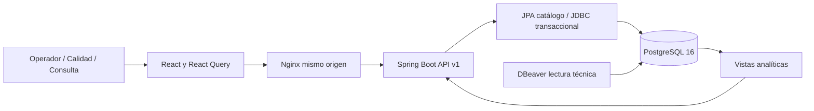

# Arquitectura y decisiones v0.1

## Continuidad con Proyecto 2

Se conserva Java 21, Spring Boot 3, Spring Data JPA, React 18, TypeScript, React Query, PostgreSQL 16 y Flyway. El catálogo Producto usa JPA; comandos y consultas analíticas usan JdbcTemplate con SQL parametrizado. Todas las escrituras de stock corren en una transacción Spring. No se ha sustituido PostgreSQL por H2 ni SQLite.

La v0.1 es un monolito por paquetes catalogo, inventario, analitica y soporte. Calidad tiene tabla propia y permisos, pero sus comandos todavía pertenecen al servicio de inventario: no se afirma que exista una separación completa por módulos. Las vistas analíticas constituyen el contrato de lectura del dashboard. Spring Modulith, esquemas compras/ventas y verificación de dependencias quedan en P1.

## Modelo y granularidad

- Producto 1:N Lote; Centro 1:N Lote. SKU y nombre de centro únicos.
- Lote 1:N Movimiento, Conteo y Decisión. Un lote representa una ubicación lógica en un centro; las ubicaciones físicas múltiples aún no existen.
- Movimiento: una entrada, merma o asignación de despacho a un lote. En un despacho FEFO que toma dos lotes hay dos líneas; este es el denominador TAC-02 de la v0.1.
- Conteo: una observación de peso con saldo esperado capturado en la misma transacción. TAC-04 usa el último conteo del período por lote, evitando duplicar reconteos.
- Las vistas `analitica.hecho_movimiento` y `analitica.hecho_conteo` exponen dimensiones por claves y fecha boliviana; no guardan porcentajes ni duplican hechos.
- Saldos derivados de entradas menos despachos y mermas. No se persiste un segundo saldo que pueda divergir.
- UUID para claves; numeric(14,3) para kg; timestamptz para eventos; date para vencimiento. El servidor impide cantidades con más de tres decimales y fechas de recepción ya vencidas.

## Semántica de los indicadores

| KPI | Numerador / denominador | Meta año 1 / 2 / 3 |
|---|---|---|
| EST-03 | kg MERMA / kg RECEPCION ×100 | ≤3,6 / 3,1 / 2,8 % |
| TAC-02 | líneas FEFO / líneas DESPACHO ×100 | ≥95 / 97 / 98 % |
| TAC-04 | últimos conteos exactos / lotes contados ×100 | ≥95 / 96,5 / 97 % |

Exactitud: diferencia absoluta ≤0,005 × peso esperado. Si esperado=0, contado debe ser 0. División por cero devuelve null. Se suman numeradores y denominadores antes de dividir. El período anterior tiene la misma cantidad de días inmediatamente antes del inicio seleccionado. El selector de año elige la meta del caso, no modifica el año de las fechas.

Merma puede superar 100 % si se destruye inventario recibido antes del período; no truncar ni ocultar. Sin entradas pero con pérdidas, la tasa es no evaluable y los kg perdidos siguen visibles. No se estima dinero con los USD 2,50/kg académicos del Business Case.

El saldo y los riesgos se calculan a la fecha actual, aplicando centro/producto, nunca el rango histórico. `VENCIDO` tiene prioridad sobre `RETENIDO`; luego se muestran liberados que vencen en siete días. Se excluye de despacho lo que vence hoy. El estado almacenado solo es RETENIDO/LIBERADO; el vencimiento se deriva de la fecha.

## Integridad y límites

Un advisory lock transaccional único serializa todas las operaciones de stock. Es una decisión conservadora para un MVP de baja concurrencia. Evita sobreventa y carreras entre calidad y despacho. En P1 se reemplazará por bloqueos ordenados por producto/centro con pruebas de concurrencia.

Idempotency-Key UUID se exige en recepción, calidad, despacho, merma y conteo. Se guarda huella SHA-256 de usuario, tipo y payload, junto a la respuesta. Repetición idéntica devuelve la respuesta; cambio de payload produce 409. Esas escrituras y la respuesta se confirman o revierten juntas. Aún no hay vencimiento/purga de claves ni outbox.

Los triggers rechazan UPDATE/DELETE sobre movimientos, conteos y decisiones. La administración de base puede alterar el esquema, por lo que esto no equivale a auditoría criptográfica. El catálogo no tiene edición; los ajustes/contramovimientos auditados son un pendiente prioritario para corregir errores sin borrar historia.

## Seguridad y despliegue

HTTP Basic local, passwords BCrypt con prefijo, credenciales aleatorias en .env, credenciales de navegador solo en memoria y servidor stateless. Cada POST exige la cabecera X-Requested-With: SIS-SOFIA, no hay CORS externo y se usan rutas del mismo origen. Esta combinación impide formularios cruzados simples; no sustituye HTTPS, OIDC, MFA, revisión de sesión y rate limiting para producción. Roles por endpoint se comprueban en el servidor.

La cuenta sofia es propietaria local de la base y Flyway usa esa conexión. Separar roles de migración, aplicación y BI es P0 de producción. Los contenedores frontend/db/Java usan un volumen PostgreSQL persistente; solo se publican puertos de loopback.

## Lectura eficiente y escalamiento

Índices por lote/fecha y centro/producto/vencimiento; lectura del dashboard en REPEATABLE READ para que numeradores y denominadores pertenezcan a un snapshot consistente. React Query separa caché por filtros, sin mezclar respuestas tardías de otra selección. Fechas limitadas a 367 días inclusivos, top 10 productos/causas y 200 riesgos. Catálogos y trazabilidad aún no están paginados.

Para millones de movimientos: agregar vistas materializadas por día/centro/producto con refresco incremental, calendario continuo, paginación y EXPLAIN ANALYZE. Conservar numeradores, denominadores y trazabilidad a hechos; no materializar promedios de porcentajes. Validar invalidación y latencia de frescura antes de introducir caché de servidor.
